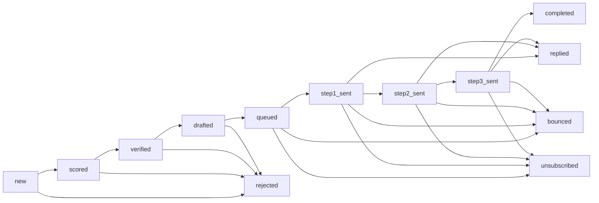

# LeadGen Agent: System Design v2 (Sellable Product, Dedicated Deployment per Client)

Date: 2026-11-19 | Owner: Asadullah | Build tool: opencode (Plan mode, then Build mode)

**Business model:** you build the tool once and **sell it to businesses**. Each business gets its **own isolated deployment** with **its own accounts** (mailboxes, data provider, LLM key). You do not run outbound campaigns for yourself, and you do not run one shared multi-tenant service. This replaces `leadgen-system-design.md` (v1, multi-tenant SaaS). If you later decide to host one shared service, v1 is still the reference.

Why this model: client-owned accounts remove most vendor-terms problems (no reselling of one Apollo account), the client is the legal sender of their own email, their data never mixes with other clients, and your running costs stay near zero.

---

## 0. How to use this file with opencode

1. Put Section 23 (`AGENTS.md`) in the repo root.
2. Per module: Plan mode (Tab), review, then Build mode. One module per session. Commit after each.
3. Follow the build order in Section 22.
4. **Read the send, suppression, limiter, state-machine and license code line by line yourself.** A coding agent can write plausible code that silently skips a check.

---

## 1. What changed from v1

| Topic | v1 (multi-tenant SaaS) | v2 (sold, dedicated deployment) |
|---|---|---|
| Hosting | You run one shared service | One stack per client (their server or yours) |
| Tenancy | `org_id` on every table, RLS | One workspace per deployment (`workspace_id` kept, so agencies can add more) |
| Database | Supabase Pro | Postgres container by default; any Postgres works (Supabase optional) |
| Billing | Merchant of Record, usage metering | Signed license key, invoices outside the product |
| Accounts | Customers connect theirs | **Required**: client supplies LLM key, verifier key, mailboxes, optional Apollo/Apify |
| Delivery | Website signup | Docker image, installer, setup wizard, update and backup scripts |
| Compliance | You enforce across tenants | Client is the sender; tool provides guardrails, client signs responsibility |
| Updates | Deploy once | Versioned images clients pull |

---

## 2. Goals and metrics (for the client)

| Goal | Metric |
|---|---|
| More customers for the client | Positive replies, meetings, customers won per 1,000 leads |
| Protect sender reputation | Hard bounce < 1% (auto-pause at 2-3%), spam complaints < 0.3% |
| Stay legal and vendor-compliant | Suppression honored 100%, lawful-basis record per lead |
| Easy for you to sell and support | Install under 30 minutes, one-command update, support bundle export |

Out of scope for v1: phone/LinkedIn outreach, built-in CRM, warm-up network, auto-reply to prospects.

---

## 3. Non-negotiable rules

1. **Agents think, code acts.** LangGraph only researches, drafts, critiques and classifies replies. Plain code sends, schedules, retries and changes state.
2. **Every external service sits behind an interface** (`LeadSource`, `Verifier`, `MailProvider`, `LLMClient`).
3. **Status changes only through `state_machine.py`.**
4. **Every job is idempotent.**
5. **Before every send:** re-check suppression, enrollment state, license state, Redis daily cap, and send window.
6. **Client-owned credentials only.** The product ships with no shared keys of yours.
7. **Compliance functions never get disabled by a license problem** (unsubscribes, suppression, bounce handling keep working).
8. **No open-tracking pixels. No auto-reply.**
9. **Secrets** from env vars or encrypted columns only. Never in code, logs or support bundles.
10. **No telemetry by default.** Anything that phones home is opt-in and documented.

---

## 4. Architecture

Logical view:

```
React dashboard --JWT--> FastAPI (routers) --> Postgres (SQLModel, async)
                              |                      ^
 Apify webhook (optional) ----+                      |
                              v                 Redis (ARQ queue,
                                                 daily caps, locks)
   +---------+----------+-------------+---------+---------+----------+
 SOURCE    VERIFY   PERSONALIZE     SEND      INBOX     OPTIMIZE
 connectors verifier LangGraph +    cron +    IMAP:     nightly
 (CSV, own  API +    LLM +          limiter   bounces + stats ->
 crawler,   MX/      critic         + SMTP    replies   reorder +
 Apollo,    catch-all                                    A/B bandit
 Apify)
```

Deployment view (one stack per client, usually one VPS):

```
Internet --443--> Caddy (auto HTTPS)
                    |-- /      -> web (static React build)
                    |-- /api   -> api (FastAPI)
                  api, worker (same image) <-> postgres, redis (volumes)
Outbound: SMTP 587 / IMAP 993 to the client's mailboxes; HTTPS to LLM, verifier, optional Apollo/Apify
```

---

## 5. Tech stack

| Layer | Choice | Why |
|---|---|---|
| API | FastAPI (async), Pydantic | Known stack; typed schemas also validate LLM output |
| ORM / DB | SQLModel + SQLAlchemy async, Postgres 16 | Row locking (`SKIP LOCKED`), runs in a container, works with Supabase too |
| Queue / cron | ARQ + Redis | Asyncio-native; Redis also holds caps, locks, JWT blacklist |
| Agents | LangGraph + OpenAI-compatible LLM client | Default Groq; `LLM_BASE_URL` lets clients use any compatible provider |
| Auth | OAuth2 password flow + JWT, Redis logout | Same pattern as your FastAPI course |
| Frontend | React | Dashboard, approvals, inbox, analytics |
| Mail | SMTP 587 + IMAP behind `MailProvider` | Works with any provider; avoids Gmail OAuth audit by default |
| Proxy / TLS | Caddy | Automatic HTTPS with a few lines of config |
| Packaging | Docker images in a private registry, Docker Compose | Simple install and update |
| Migrations | Alembic, run on API start | Updates are `pull` + restart |

---

## 6. Repo structure

```
leadgen/
  app/
    main.py
    core/                  # config, db, redis, security (JWT, Fernet), license.py, branding.py
    models/                # SQLModel tables
    schemas/               # Pydantic
    routers/               # auth, setup, connections, domains, mailboxes, campaigns, leads,
                           # inbox, analytics, compliance, system (health, license, diagnostics)
    services/
      sources/             # base.py, csv_import.py, website.py, apollo.py, apify.py
      verify/              # base.py, syntax.py, mx.py, catchall.py, api_verifier.py
      mail/                # base.py, smtp.py, imap.py, bounce_parser.py
      agents/              # personalize_graph.py, reply_classifier.py, prompts/
      sequencing/          # state_machine.py, limiter.py, scheduler.py, windows.py
      compliance/          # suppression.py, rules_by_country.py, footer.py
      budget/              # spend_caps.py (verification, LLM, source budgets)
    workers/               # arq_settings.py + source, verify, personalize, send, inbox, optimize
  frontend/
  deploy/
    docker-compose.yml     # caddy, web, api, worker, postgres, redis
    Caddyfile
    .env.example
    install.sh             # preflight checks, generates secrets, starts stack
    backup.sh              # pg_dump + retention
    update.sh              # pull new image, migrate, restart, rollback on failure
    support-bundle.sh      # redacted logs + config + versions
  docs/                    # install guide, DNS guide, runbook, compliance guide
  tests/                   # pytest with Fake providers
  AGENTS.md
```

---

## 7. Delivery and deployment package

### 7.1 Delivery options

| Option | Who runs the server | Your data access | Good for |
|---|---|---|---|
| A. Self-host | Client's IT | None (unless they send a support bundle) | Technical clients, strict privacy |
| B. Done-for-you install | Client's server, you install and hand over | Temporary, during install and support | Most small businesses |
| C. Managed dedicated instance | You host one stack per client and rebill | Full (you become their data processor) | Clients without IT; needs a DPA |

Start with B and C. Option C makes you a processor under GDPR: you need a DPA, a subprocessor list, backups and an incident process.

### 7.2 Compose file (sketch)

```yaml
services:
  caddy:
    image: caddy:2
    ports: ["80:80", "443:443"]
    volumes: ["./Caddyfile:/etc/caddy/Caddyfile", "caddy_data:/data", "web_dist:/srv"]
    depends_on: [api]
  api:
    image: registry.example.com/leadgen:${VERSION}
    command: sh -c "alembic upgrade head && uvicorn app.main:app --host 0.0.0.0 --port 8000"
    env_file: .env
    depends_on: [db, redis]
  worker:
    image: registry.example.com/leadgen:${VERSION}
    command: arq app.workers.arq_settings.WorkerSettings
    env_file: .env
    depends_on: [db, redis]
  db:
    image: postgres:16
    environment: { POSTGRES_PASSWORD: ${DB_PASSWORD}, POSTGRES_DB: leadgen }
    volumes: ["pgdata:/var/lib/postgresql/data"]
  redis:
    image: redis:7
    command: redis-server --appendonly yes
    volumes: ["redisdata:/data"]
volumes: { caddy_data: {}, web_dist: {}, pgdata: {}, redisdata: {} }
```

### 7.3 Environment variables

`PUBLIC_URL`, `VERSION`, `DATABASE_URL` or `DB_PASSWORD`, `REDIS_URL`, `SECRET_KEY` (JWT), `FERNET_KEY` (encrypts stored credentials; generated by `install.sh`), `LLM_BASE_URL`, `LLM_API_KEY`, `LLM_MODEL_SMALL`, `LLM_MODEL_LARGE`, `VERIFIER_PROVIDER`, `VERIFIER_API_KEY`, `LICENSE_KEY`, `BRAND_NAME`, `BRAND_LOGO_URL`, spend caps (`MAX_LLM_USD_PER_DAY`, `MAX_VERIFICATIONS_PER_DAY`, `MAX_SOURCE_CREDITS_PER_DAY`).

Optional: `APOLLO_API_KEY` (client's own), `APIFY_TOKEN` (client's own).

### 7.4 Install flow (target: under 30 minutes)

1. Client or you provision a VPS and point a domain to it.
2. `./install.sh`: preflight (Docker present, ports 80/443 open, DNS resolves), generate `SECRET_KEY`, `FERNET_KEY`, `DB_PASSWORD`, write `.env`, start stack.
3. Open `PUBLIC_URL/setup`: create admin, paste license key and LLM key, choose verifier, set sender identity and **postal address** (mandatory for the email footer).
4. Wizard step: add sending domain, show SPF/DKIM/DMARC records to add, re-check DNS until green.
5. Wizard step: connect mailboxes (SMTP/IMAP test send and fetch), set daily caps, start warm-up.
6. Create the first campaign (product, ICP, sequence), import 20 leads, run in approval mode.

### 7.4a Update, backup, rollback

- `update.sh`: record current version, pull new image, run migrations, health-check `/health`, roll back to previous image if it fails.
- `backup.sh`: nightly `pg_dump`, keep 7 daily and 4 weekly, optional copy to the client's object storage. Test a restore at install.
- Never auto-update silently; show "update available" in the dashboard.

---

## 8. Licensing and white-label

- **License key** = signed token (Ed25519; public key embedded in the app) with: customer, plan, `max_mailboxes`, `max_leads_per_month`, `expires_at`, features. Verified offline.
- **Soft enforcement.** If missing or expired: block creating new campaigns and sourcing new leads, show a banner, and keep unsubscribes, suppression, bounce and reply handling running. Add a 14-day grace period.
- **Be honest about limits:** self-hosted software can be modified or copied. Your protection is the contract, update access, support and value. If you need tight control, sell option C (you host).
- **White-label:** brand name, logo and colors from settings; remove your name from emails and UI where the contract allows.
- Keep source private. Ship images from a private registry with a per-client pull token.

---

## 9. Security

- Passwords hashed (bcrypt/argon2). JWT access tokens plus Redis blacklist for logout. Optional TOTP for admins.
- Stored credentials (SMTP/IMAP passwords, API keys) encrypted with `FERNET_KEY`; never returned by the API after saving.
- HTTPS only through Caddy. Database and Redis not exposed publicly (internal Docker network only).
- Webhooks (Apify) verified by shared secret.
- Rate-limit login and API (Redis).
- Backups encrypted at rest if sent off-box.
- Support bundle redacts secrets and email bodies by default.
- Dependency pinning, `pip-audit` / `npm audit` in CI, signed images.

---

## 10. Data model

Single workspace per deployment. Keep `workspace_id` on tenant tables so agencies can add workspaces later without a migration.

| Table | Key columns |
|---|---|
| `workspaces` | id, name, sender_identity, postal_address, footer_text, timezone |
| `users` | id, workspace_id, email, password_hash, role, totp_secret |
| `connections` | id, workspace_id, kind (llm/verifier/apollo/apify/smtp/imap), encrypted_secret, status |
| `domains` | id, workspace_id, name, spf_ok, dkim_ok, dmarc_ok, warmup_started_at |
| `mailboxes` | id, workspace_id, domain_id, address, daily_cap, status (warming/active/paused), health_score |
| `campaigns` | id, workspace_id, name, product (jsonb), icp (jsonb), status, compliance_mode, require_approval |
| `sequence_steps` | id, campaign_id, step_no, delay_days, angle_hint |
| `leads` | id, workspace_id, source, company_domain, company_name, person_name, title, country, icp_score, lawful_basis, collected_at, raw (jsonb) |
| `lead_emails` | id, lead_id, email, verify_status, verified_at, role_based |
| `enrollments` | id, campaign_id, lead_id, lead_email_id, mailbox_id, status, step_no, next_send_at, variant_id |
| `messages` | id, enrollment_id, direction, message_id, in_reply_to, thread_id, subject, body, variant_id, sent_at |
| `events` | id, enrollment_id, type, payload (jsonb), at |
| `suppression` | id, email_hash, domain, reason, at (unique on email_hash) |
| `experiments` | id, campaign_id, kind, variants (jsonb), stats (jsonb) |
| `spend_ledger` | id, day, kind (llm/verify/source), units, est_usd |
| `license_state` | id, token, valid_until, last_checked_at |

Indexes: `enrollments(status, next_send_at)`, `suppression(email_hash)`, `messages(message_id)`, `leads(workspace_id, company_domain)`.

---

## 11. Lead lifecycle



```python
# services/sequencing/state_machine.py
ACTIVE = {"queued", "step1_sent", "step2_sent", "step3_sent"}
EXIT = {"replied", "bounced", "unsubscribed"}
ALLOWED = {
    "new": {"scored", "rejected"},
    "scored": {"verified", "rejected"},
    "verified": {"drafted", "rejected"},
    "drafted": {"queued", "rejected"},
    "queued": {"step1_sent"} | EXIT,
    "step1_sent": {"step2_sent", "completed"} | EXIT,
    "step2_sent": {"step3_sent", "completed"} | EXIT,
    "step3_sent": {"completed"} | EXIT,
}

async def transition(db, e, new_status, reason, payload=None):
    if new_status not in ALLOWED.get(e.status, set()):
        raise IllegalTransition(e.status, new_status)
    e.status = new_status
    if new_status in EXIT | {"completed", "rejected"}:
        e.next_send_at = None
    db.add(Event(enrollment_id=e.id, type=f"status:{new_status}",
                 payload={"reason": reason, **(payload or {})}))
```

---

## 12. Interfaces

```python
class RawLead(BaseModel):
    company_name: str | None; company_domain: str | None
    person_name: str | None; title: str | None; email: str | None
    country: str | None; source: str; raw: dict

class LeadSource(Protocol):
    name: str
    async def fetch(self, query: dict, limit: int) -> list[RawLead]: ...

class VerifyResult(BaseModel):
    status: Literal["valid", "risky", "invalid", "unknown"]; reason: str

class Verifier(Protocol):
    async def verify(self, email: str) -> VerifyResult: ...

class MailProvider(Protocol):
    async def send(self, mailbox, msg) -> str: ...                       # returns Message-ID
    async def fetch_new(self, mailbox, since_uid: int) -> list: ...

class LLMClient(Protocol):
    async def complete(self, model: str, messages: list, schema: type[BaseModel] | None) -> Any: ...
```

Default sources: `csv_import` and `website` (client's own data and public company pages). `apollo` and `apify` are optional connectors that use the **client's own key**. Write a `Fake*` for each interface; tests never touch the network.

---

## 13. Jobs and the send engine

| Job | Trigger | Rule |
|---|---|---|
| `source_leads` | User action or webhook | Check source budget; store raw JSON; dedupe by email and domain+name; score ICP |
| `verify_email` | After source | Check verification budget; only `valid` (and a capped share of `risky`) continue |
| `personalize` | After verify | Check LLM budget; LangGraph; max 2 retries |
| `send_due` | ARQ cron, every minute | See code |
| `poll_inbox` | ARQ cron, every 2-5 min per mailbox | Bounce parser + reply classifier |
| `optimize` | Nightly | Stats, bandit update, queue reorder |
| `reverify_stale` | Weekly | Re-verify addresses older than 30 days before sending |
| `license_check` | Daily | Validate token, update `license_state` |
| `backup_check` | Daily | Warn on the dashboard if the last backup is older than 48 h |

```python
async def send_due(ctx):
    if not await sending_enabled(ctx["redis"]): return          # global kill switch
    async with session() as db:
        rows = (await db.exec(
            select(Enrollment)
            .where(Enrollment.status.in_(ACTIVE), Enrollment.next_send_at <= now())
            .order_by(Enrollment.next_send_at).limit(50)
            .with_for_update(skip_locked=True)
        )).all()
        for e in rows:
            if await is_suppressed(db, e):
                await transition(db, e, "unsubscribed", "suppressed"); continue
            if not license_allows_sending(db):  continue         # soft lock: never blocks compliance paths
            mb = await pick_mailbox(db, e)                       # sticky mailbox for follow-ups
            if mb is None or mb.status != "active": continue
            if not in_send_window(e):
                e.next_send_at = next_window(e); continue
            if not await limiter.try_acquire(ctx["redis"], mb.id, mb.daily_cap): continue
            msg = build_message(e, mb)                           # List-Unsubscribe, In-Reply-To, References, footer
            try:
                message_id = await ctx["mail"].send(mb, msg)
            except TransientError:
                await limiter.release(ctx["redis"], mb.id)
                e.next_send_at = backoff(e); continue
            record_message(db, e, msg, message_id)
            await advance_step(db, e)
        await db.commit()
```

```python
async def try_acquire(redis, mailbox_id, cap) -> bool:
    key = f"cap:{mailbox_id}:{date.today():%Y%m%d}"
    n = await redis.incr(key)
    if n == 1: await redis.expire(key, 60 * 60 * 30)
    if n > cap:
        await redis.decr(key); return False
    return True
```

Also: per-hour pacing and 30-180 s random jitter per mailbox.

**Spend caps** (important because the client pays vendors directly): `budget/spend_caps.py` checks daily limits for LLM, verification and source credits before each call, records usage in `spend_ledger`, and shows today's and month-to-date estimates on the dashboard. A cap hit pauses that step and raises a dashboard alert.

---

## 14. Personalization agent (LangGraph)

```
score_icp -> research -> pick_angle -> draft -> critic --pass--> save
                                         ^         |
                                         +--retry--+ (max 2)     --fail--> reject / human review
```

```python
class Draft(BaseModel):
    subject: str = Field(max_length=70)
    body: str = Field(max_length=900)
    claims: list[str]            # every factual claim about the recipient

class DraftState(TypedDict):
    lead: dict; context: str; angle: str; draft: dict | None; critic: dict | None; attempts: int
```

- **research:** fetch and cache the company site and news by domain. Summarize with the small model.
- **draft:** larger model, strict `Draft` schema.
- **critic checks:** every claim is supported by `context`; under about 120 words; one CTA; mentions the client's real product; no spam-trigger phrases; no fake familiarity; footer added by code, not by the LLM.
- Default `require_approval = true` for a client's first 50 emails.
- Prompts live in `prompts/` as versioned files so you can tune without code changes.

---

## 15. Verification pipeline

1. Syntax. 2. MX lookup. 3. Disposable and role-address filter. 4. Catch-all detection. 5. Verification API.

SMTP probing from cloud servers is unreliable (port 25 is often blocked), so the API step is the authority. `valid` sends; `risky` sends at a capped share; `invalid` never. Re-verify after 30 days. Store vendor result and timestamp.

---

## 16. Inbox: bounces and replies

| Event | Action |
|---|---|
| Hard bounce (DSN 5.x.x) | Mark email invalid, suppress, `bounced` |
| Soft bounce (4.x.x) | Retry later; after 2-3 tries treat as hard |
| Reply | Stop sequence (`replied`), then classify |
| Unsubscribe (reply or link) | Suppress immediately and permanently |
| Out-of-office | Pause until return date if parsed |
| Spam complaint | Suppress, count toward mailbox health |

Match inbound mail by `In-Reply-To` / `References` to `messages.message_id`. Classes: `interested, question, not_now, not_interested, unsubscribe, out_of_office, referral, auto_reply, other`. `interested` and `question` notify the client (email/Telegram/webhook) with a suggested reply draft. If hard-bounce rate exceeds 2-3% or complaints approach 0.3% in a rolling window, auto-pause the mailbox.

---

## 17. Deliverability rules (enforced by the product)

- Sending domains should be **secondary domains**, not the client's main domain. The setup wizard says so.
- Block sending until SPF, DKIM and DMARC checks are green.
- Warm-up period per mailbox; ramp caps over weeks.
- Rule of thumb: about 30-50 cold emails per mailbox per day. Scale by adding mailboxes.
- One-click unsubscribe headers on every email. Plain-text-leaning, one link maximum, no attachments, no open pixels.
- One mailbox per thread with proper threading headers.

---

## 18. Compliance and vendor terms (client-owned accounts)

I am not a lawyer. Have one review your license agreement and documents before you sell.

**Vendor constraints (as published; re-check before selling)**

| Vendor | Constraint | Design response |
|---|---|---|
| Apollo | API terms bar selling or sublicensing API access, and bar integrating the API with your product unless Apollo approves; data licensed for the customer's internal business use | Apollo is an **optional connector using the client's own key**. Ask Apollo about an approved integration or partner route before advertising it. Default sources are CSV import, the client's own data, and the website crawler |
| Google (Gmail API) | Restricted scopes need verification and an annual third-party security assessment when data passes through servers you operate | Default to SMTP/IMAP. If a client wants Gmail OAuth, use that client's own Google Cloud project (check whether an internal/Workspace app avoids verification) |
| Apify | Per-Actor terms; scraping legality depends on the target | Client's own token; do not ship scrapers for sites that forbid it; warn in the UI |
| LLM provider | Standard API terms | Client's own key; document in your privacy notes which data is sent |

**Email law (the recipient's location decides)**

| Region | Rule of thumb |
|---|---|
| US (CAN-SPAM) | No prior consent for B2B; honest sender identity, truthful subject, postal address, working opt-out |
| EU / UK (GDPR + ePrivacy/PECR) | Documented lawful basis (legitimate interest assessment), relevance to the person's role, immediate opt-out |
| Germany | Stricter (UWG section 7): treat as consent-required |
| Canada (CASL) | Consent needed (express or narrow implied exceptions) |
| Mailbox providers | SPF/DKIM/DMARC, one-click unsubscribe, complaints under 0.3% |

**Built-in guardrails**
- `compliance_mode` per campaign: default-block Germany and Canada unless the client records a lawful basis.
- Per-lead record of source, `lawful_basis`, `collected_at`.
- Mandatory footer (sender identity, postal address, opt-out). The tool will not send until filled.
- Suppression list per deployment; import and export it.
- "Forget this person" endpoint that suppresses and wipes personal fields.
- First-run screen where the client accepts responsibility for list sources and content.

---

## 19. Optimizer (maximizes the client's customers)

- Track **positive reply rate** and customers won, not opens.
- A/B test subject, opener, CTA with Thompson sampling and a minimum sample.
- Logistic regression on lead features (industry, size, role, country) to predict positive replies; reorder the queue.
- Weekly email report: best segment, best angle, cost per positive reply (using `spend_ledger`).

---

## 20. API and frontend

Routers: `/auth`, `/setup` (first-run wizard), `/connections`, `/domains`, `/mailboxes`, `/campaigns`, `/leads`, `/inbox`, `/analytics`, `/compliance`, `/system` (health, version, license, support bundle).

Screens: setup wizard; domain/DNS check; mailboxes; campaign builder; lead list; draft approval queue; inbox with reply classes; analytics with spend; compliance settings; system page (version, license, backups, update available).

---

## 21. Observability and support

- Structured logs with `enrollment_id` and `job`; never log secrets or full bodies.
- `/health` (db, redis, worker heartbeat, last inbox poll per mailbox, last backup).
- Dashboard alerts: bounce rate high, queue stuck, spend cap hit, license expiring, backup old.
- `support-bundle.sh`: versions, config (secrets redacted), last 24 h of logs, job stats. Client emails it to you; you never need their passwords.
- Global kill switch `SENDING_ENABLED` and per-mailbox pause.

---

## 22. Build order for opencode (with prompts)

| # | Module | Prompt (use Plan mode first) | Acceptance test |
|---|---|---|---|
| 1 | Models + migrations | "Create SQLModel tables from Section 10 with workspace_id, async session, Alembic." | Migrations run clean on empty Postgres |
| 2 | State machine | "Implement state_machine.py per Section 11 with tests for every allowed and illegal transition." | Illegal transitions raise |
| 3 | Limiter + windows | "Redis daily cap limiter and send-window logic per Section 13 with concurrency tests." | Cap never exceeded |
| 4 | Suppression + compliance | "Suppression, footer builder, country rules, forget-person." | Suppressed email never sent |
| 5 | send_due + FakeMailProvider | "Implement send_due per Section 13 with SKIP LOCKED and tests for double-send, suppression, cap, transient failure." | Two workers never double-send |
| 6 | Inbox worker | "Bounce parser, reply matching, classifier interface with a fake LLM." | Reply stops sequence; hard bounce suppresses |
| 7 | Auth + setup wizard API | "OAuth2 + JWT, Redis logout, /setup flow, encrypted connections." | Secrets never returned by API |
| 8 | Spend caps + ledger | "budget/spend_caps.py with daily limits for LLM, verification, sources." | Cap hit pauses the step |
| 9 | Sources + verify | "LeadSource/Verifier interfaces, CSV import, website crawler, verification pipeline." | Full pipeline test with fakes |
| 10 | LangGraph agent | "personalize_graph per Section 14 with Pydantic Draft and critic." | Critic rejects invented claims |
| 11 | License | "Ed25519 signed license, offline verify, soft enforcement that never blocks compliance paths." | Expired license blocks sourcing, not unsubscribes |
| 12 | Packaging | "deploy/ folder: compose, Caddyfile, install.sh, update.sh with rollback, backup.sh, support-bundle.sh." | Fresh VPS install under 30 min; update and rollback tested |
| 13 | React dashboard + wizard | "Build screens from Section 20." | Manual walkthrough |
| 14 | Optimizer + weekly report | "Bandit, ICP model, report email." | Variant traffic shifts after sample threshold |

---

## 23. `AGENTS.md` (paste into repo root)

```
# LeadGen Agent (sold as dedicated deployments)
Stack: FastAPI (async), SQLModel, Postgres, ARQ + Redis, LangGraph + OpenAI-compatible LLM, React, Docker Compose, Caddy.
Read leadgen-system-design-v2.md before any task.
- Routers in app/routers, Pydantic schemas in app/schemas, tables in app/models.
- Client-owned credentials only. No shared keys, no telemetry by default.
- External services only behind interfaces: LeadSource, Verifier, MailProvider, LLMClient.
- Status changes ONLY via services/sequencing/state_machine.py.
- All jobs idempotent. send_due order: kill switch -> SKIP LOCKED -> suppression -> license -> window -> Redis cap -> send.
- License problems may block sourcing and new sends but NEVER unsubscribes, suppression or bounce handling.
- Secrets from env vars or encrypted columns only. Never log secrets or email bodies.
- Tests use Fake providers and never touch the network or send real email.
- Write pytest tests for state machine, limiter, suppression, bounce parser, license, spend caps.
- No open-tracking pixels. No auto-reply to prospects.
- Every code must be beginner friendly and must be easy and simple because don't overkill and overengineer if simple code works and solves the problem (Qoute : Less is always more).
```

---

## 24. Selling checklist

**Contract and legal (lawyer review)**
- License agreement: scope, term, updates, support hours, response times.
- Acceptable use: client is the sender, responsible for lists, lawful basis and content; no spam, no illegal data.
- Limitation of liability, no guarantee of results or deliverability, indemnity for misuse.
- Privacy: if you host (option C) add a DPA and subprocessor list; if self-hosted, state that you do not access their data.
- Third-party terms: clients must hold their own accounts and accept those vendors' terms.

**Operations**
- Install guide, DNS guide, runbook, compliance guide, FAQ.
- Onboarding call script: domains, mailboxes, warm-up, first campaign in approval mode.
- Support process: email, bundle export, response targets.
- Release process: versioned images, changelog, tested update and rollback.
- Invoicing outside the product (bank transfer or invoicing tool); confirm payment method and tax treatment with an accountant.

**Sales**
- Be clear that deliverability and results depend on the client's domains, list quality and offer.
- Offer a paid pilot (setup + 30 days) before long contracts.

---

## 25. Decisions and open risks

| Decision | Reason |
|---|---|
| Dedicated deployment per client | Clean isolation, vendor terms friendlier, near-zero running cost for you |
| Postgres container by default | Free, one box; Supabase still works via `DATABASE_URL` |
| SMTP/IMAP default | Avoids Gmail restricted-scope audit |
| Apollo optional, client's own key | Avoids reselling one account; still confirm with Apollo |
| Soft license enforcement | Never risk breaking opt-outs or bounce handling |
| Spend caps in the product | Clients pay vendors directly and need protection from surprise bills |
| No auto-reply v1 | Risk of embarrassing or non-compliant replies |

Open risks: Apollo approval route; copying of self-hosted software (mitigate with option C and contract); support load per client; per-country legal review; clients ignoring deliverability advice and blaming the tool.